<div align="center">

<picture><source media="(prefers-color-scheme: dark)" srcset="promo/logo-white.png">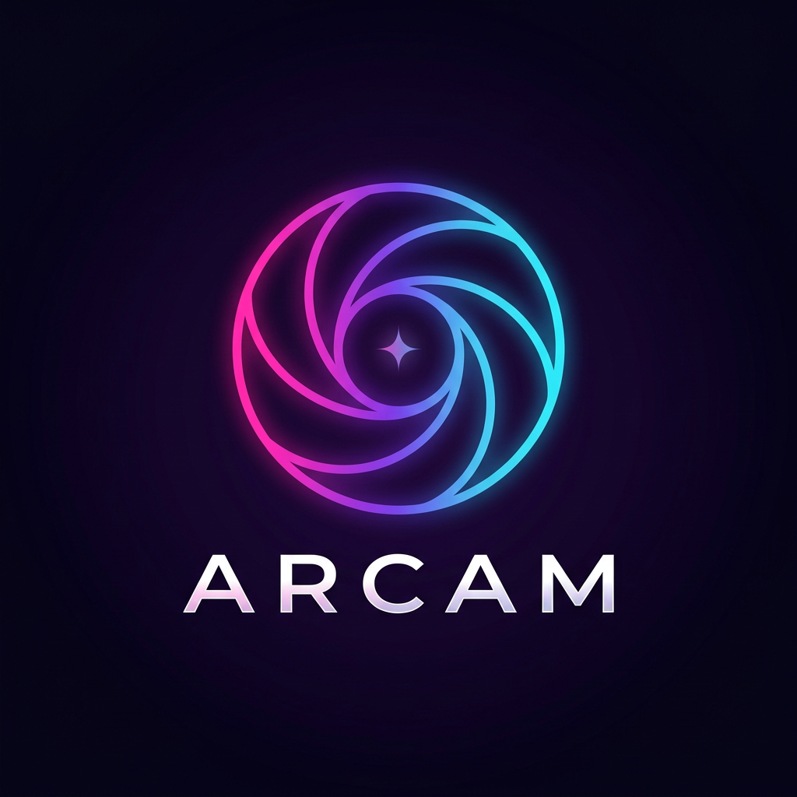</picture>

# 📸 ARCAM — AR Camera Studio

<p align="center">
  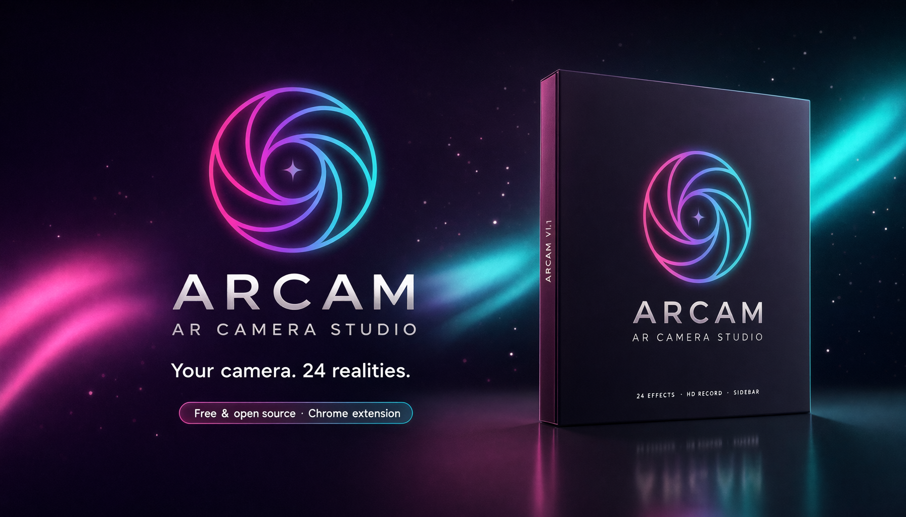
</p>


**Open-source Chrome extension that turns your webcam into an IG/TikTok-style AR camera.**
23 live GPU filters · 15 face-tracked stickers · particles · one-click WebM recording with audio.

Everything runs **100% on-device** — no uploads, no accounts, no tracking.

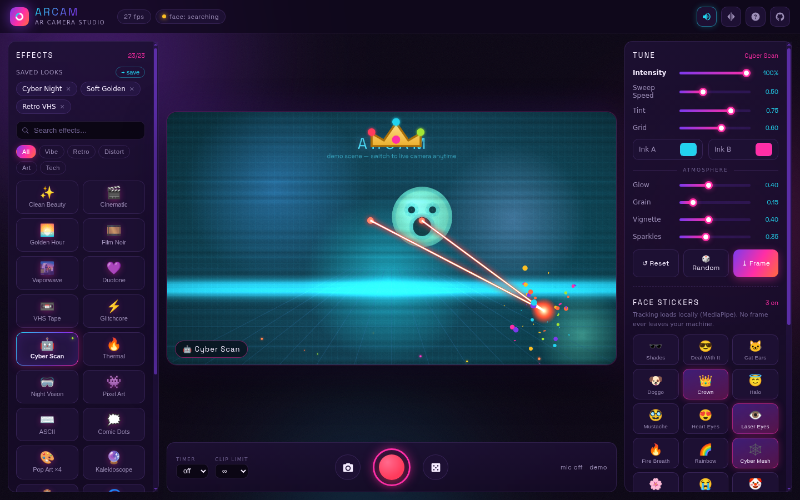

</div>

---

## ✨ Features

- **23 real-time WebGL effects** across 5 categories — Cinematic, Golden Hour, Film Noir, Vaporwave, Duotone, VHS, Glitchcore, Cyber Scan, Thermal, Night Vision, Pixel Art, ASCII, Comic Dots, Pop Art ×4, Kaleidoscope, Mirror House, Swirl, Fisheye, Water Ripple, RGB Split, Dream Bloom, Negative and Clean Beauty.
- **Live tuning deck** — every effect exposes its own parameter sliders (plus color pickers for Duotone / Cyber Scan), a global intensity blend, and shared atmosphere controls: glow, grain, vignette and ambient sparkles. All applied instantly on the GPU.
- **15 face-anchored AR stickers** powered by a fully local MediaPipe FaceMesh (WASM): shades, deal-with-it, cat ears, doggo (with tongue when you open your mouth), crown, halo, mustache, heart eyes, **laser eyes that follow your cursor**, fire breath & rainbow (triggered by opening your mouth), cyber mesh, blush, tears and clown. Stickers stack, scale, tilt with your head — and gracefully float at frame center when no face is present.
- **Recording** — one button captures the composited frame (effects + stickers + particles) to **WebM (VP9/VP8 + Opus)** via `MediaRecorder`, with optional microphone audio, clip length limits (15/30/60s), live REC timer, and a preview modal with download.
- **Photos** — PNG capture with flash + shutter, optional 3s/10s countdown timer, instant frame export.
- **Saved looks** — save any effect + params + sticker combo as a one-click look; seeded presets included; delete with **Undo**.
- **Interactive stage** — click anywhere for a confetti burst; Water Ripple follows your cursor; laser eyes track your pointer.
- **Camera controls** — device picker, 480p/720p/1080p, mirror, render quality (Full / Balanced / Performance), mic toggle, tracking toggle.
- **Demo mode** — a built-in animated neon scene so every feature works even without a camera (or before you grant permission).
- **Sound design** — tiny WebAudio synth tied to visible events (shutter, countdown beeps, record chirps, effect pops). One mute button up top.
- **Keyboard shortcuts** — `Space` record · `P` photo · `R` randomize · `M` mirror · `S` sound · `←/→` cycle effects · `?` help.
- **Sidebar or full screen** — the toolbar icon opens a compact side-panel studio (~¼ of the window); **⛶** promotes it to a full tab / browser fullscreen.
- **Settings page** — startup defaults for effect, source, resolution, render quality, recording bitrate (4–16 Mbps), countdown, clip limit, mirror, sound, tracking and mic. Auto-saved to `chrome.storage.local`, shared by sidebar and tab.
- Responsive layout down to phone widths, custom in-palette scrollbars, animated aurora background.

## 🚀 Install (load unpacked)

1. Clone or download this repo:
   ```bash
   git clone https://github.com/aisac-id/arcam.git
   ```
2. Open `chrome://extensions` in Chrome (or any Chromium browser: Edge, Brave, Arc…).
3. Enable **Developer mode** (top-right toggle).
4. Click **Load unpacked** and select the `arcam` folder.
5. Pin the ARCAM icon and click it — the studio opens in the **browser sidebar** (side panel). Allow camera access when prompted (or press **Demo mode**).
6. Inside the panel, hit **⛶** to promote the studio to a full tab — there, ⛶ toggles browser full screen. The **gear** opens the Settings page.

> Requires a Chromium-based browser with WebGL. No build step, no dependencies to install — the repo is the extension.

## 🎬 How to use

1. Pick an effect from the left library (search / category tabs).
2. Shape it with the sliders on the right — changes are live.
3. Stack face stickers; open your mouth for fire 🔥 / rainbow 🌈, move your cursor for lasers.
4. Hit the big red button (or `Space`) to record; hit it again to stop, preview and download the `.webm`.
5. Save the combo as a **look** so you can recall it in one click.

| | |
|---|---|
| 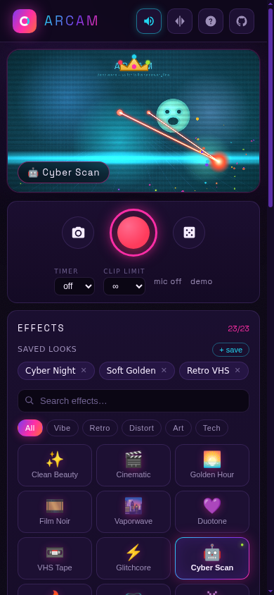 | The whole studio reflows for narrow windows — stage first, capture bar, then effects and the full control deck. |

## 🔒 Privacy

- Camera frames, face landmarks, photos and recordings **never leave your machine**.
- MediaPipe FaceMesh ships inside the extension (`vendor/face_mesh/`) and runs as local WASM — no CDN, no network calls at runtime.
- The extension requests **no host permissions** and declares no content scripts. The only permission prompt is the standard camera/microphone one, triggered by you. `sidePanel` and `storage` are used purely for the sidebar and local settings.
- Recordings are kept in memory until you press **Download**; discarding frees them immediately.

## 🧠 Tech notes

| Layer | Implementation |
|---|---|
| Effects | Single fullscreen WebGL pass, one uber-shader with 23 branches + shared glow/grain/vignette post. Video texture uploaded per frame; `preserveDrawingBuffer` for capture. |
| Face tracking | MediaPipe FaceMesh (468 landmarks), throttled async pump (every 2nd frame, non-blocking). Landmarks → anchor set (eyes, mouth openness, head roll) → canvas-2D sticker renderer. |
| Recording | Offscreen composite canvas (`GL output + sticker overlay`) → `captureStream(30)` → `MediaRecorder` (VP9→VP8→WebM→MP4 fallback chain), optional mic track. |
| State | Plain JS module state + `localStorage` persistence (per-effect param memory, looks, toggles). |
| Audio | Zero-asset WebAudio synth; every sound maps to a visible event. |

### MV3 CSP patch (important for contributors)

Manifest V3 forbids `unsafe-eval`, but MediaPipe's embind glue generates functions with `new Function(...)`. The vendored `face_mesh_solution_*_wasm_bin.js` files contain **three small surgical patches** that replace code-generation with equivalent closures, keeping the extension CSP-clean (`script-src 'self' 'wasm-unsafe-eval'`):

1. `createNamedFunction` → plain wrapper (names are cosmetic).
2. `craftInvokerFunction` → closure that performs the same `toWireType`/invoker/destructor/`fromWireType` wiring.
3. `__emval_get_method_caller` → closure that reads args from the heap and calls the JS method.

If you upgrade MediaPipe, re-apply these patches (search for `createNamedFunction`, `craftInvokerFunction`, `__emval_get_method_caller`). Behavior is identical; only the eval-based codegen is removed.

## 🗂 Project layout

```
arcam/
├── manifest.json          # MV3 manifest (sidePanel + storage, no host permissions)
├── background.js          # toolbar click → opens the sidebar panel
├── studio.html            # the whole app shell (sidebar + full tab)
├── options.html           # Settings page (startup defaults)
├── css/studio.css         # palette, layout, components, motion
├── css/options.css        # Settings page styling
├── js/
│   ├── app.js             # orchestrator: state, UI, capture, loop
│   ├── settings.js        # shared defaults model (chrome.storage.local)
│   ├── options.js         # Settings page logic
│   ├── gl.js              # WebGL pipeline + uber-shader
│   ├── effects.js         # effect & sticker metadata
│   ├── stickers.js        # face-anchored canvas renderer
│   ├── particles.js       # confetti / fire / rainbow / sparkles
│   ├── face.js            # MediaPipe wrapper
│   └── audio.js           # WebAudio sfx synth
├── vendor/face_mesh/      # local MediaPipe (CSP-patched, see above)
├── promo/                 # logo, software box, poster, banner, promo video
└── icons/
```

## 🤝 Contributing

PRs welcome! Ideas: new shader branches in `js/gl.js` + metadata in `js/effects.js`, new stickers in `js/stickers.js`, hand tracking, GIF export, background segmentation. Keep it dependency-free and on-device.

## 📄 License

MIT © 2026 aisac-id. MediaPipe assets are Apache-2.0 (Google). See [LICENSE](LICENSE).


---

## Brand & Promotion Kit

Aset branding resmi **Arcam** — logo, software box, poster, banner, dan materi sosial.
Semua aset berada di folder [`promo/`](promo/) dan bebas dipakai untuk materi promosi proyek ini.

<p align="center">
  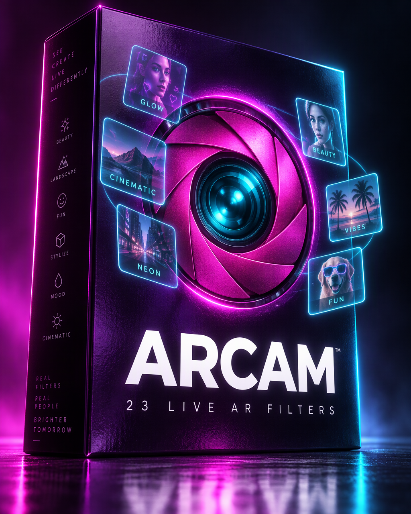
</p>

| Aset | Pratinjau | Ukuran |
|---|---|---|
| Logo | <picture><source media="(prefers-color-scheme: dark)" srcset="promo/logo-white.png"></picture> | 1024×1024 |
| Logo (mode gelap) | 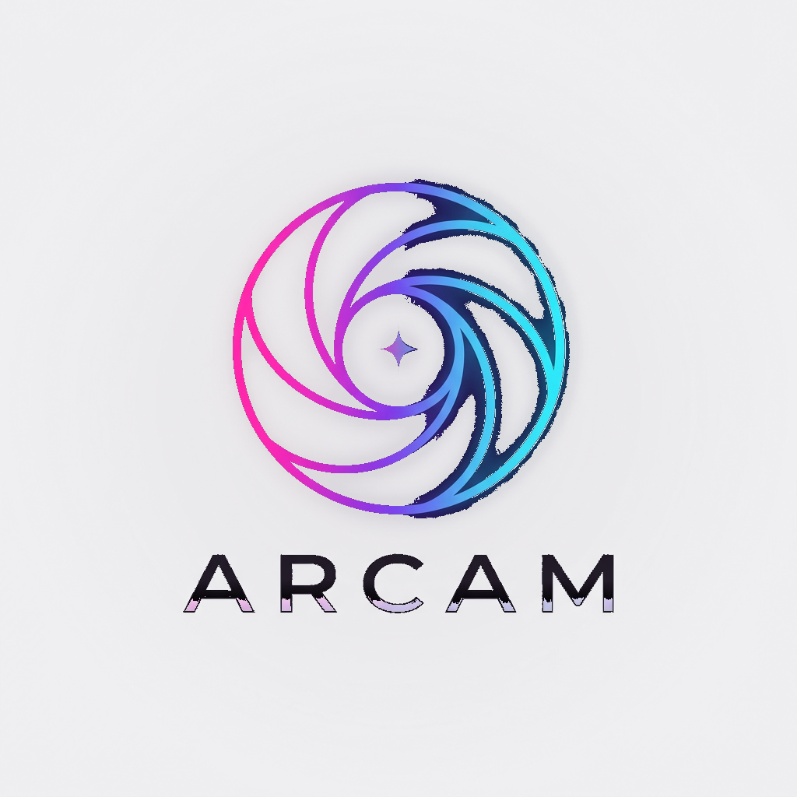 | 1024×1024 |
| Wordmark | 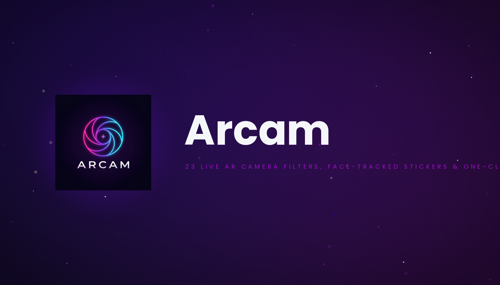 | 1600×500 |
| Software Box |  | 1600×1200 |
| Poster | 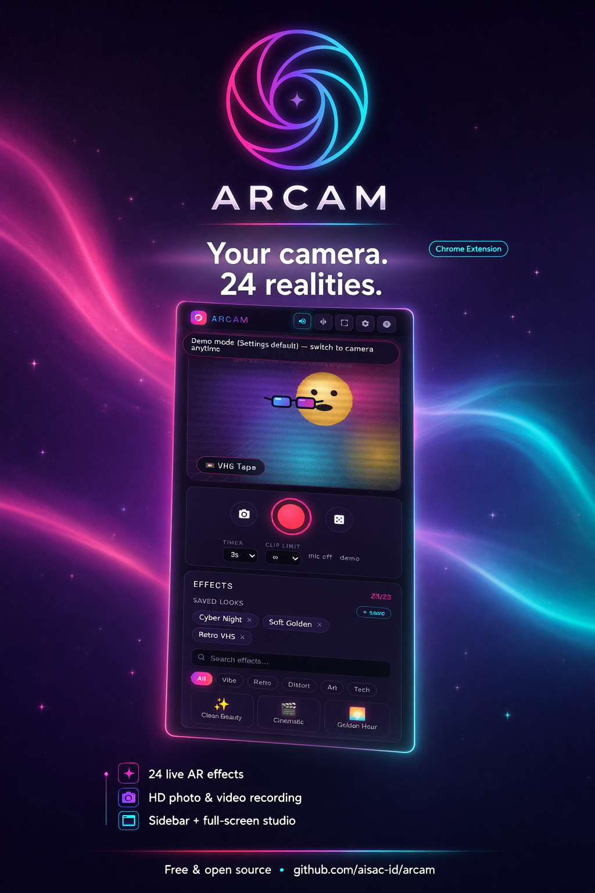 | 1200×1600 |
| Banner |  | 1920×820 |
| Social Preview | 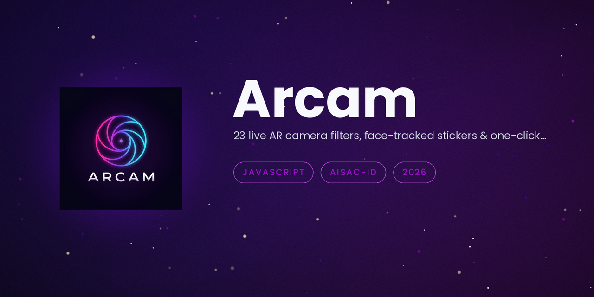 | 1280×640 |
| Feature Showcase | 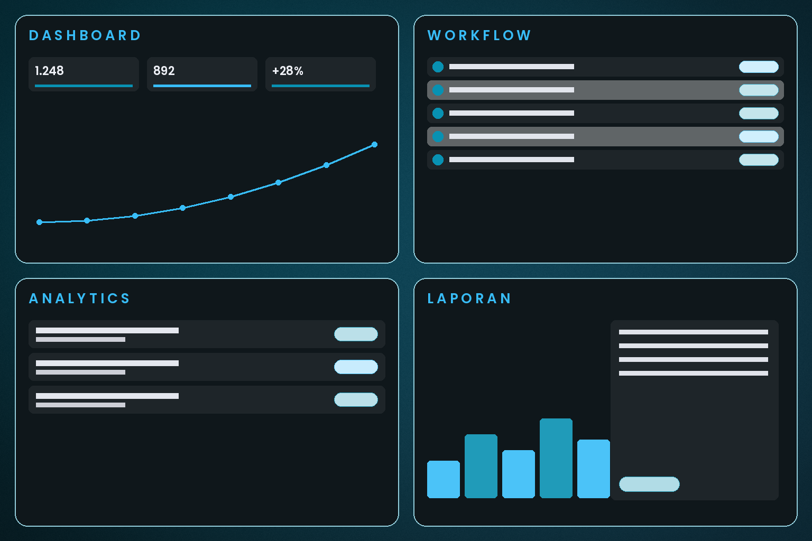 | 1600×1000 |
| Social Square | 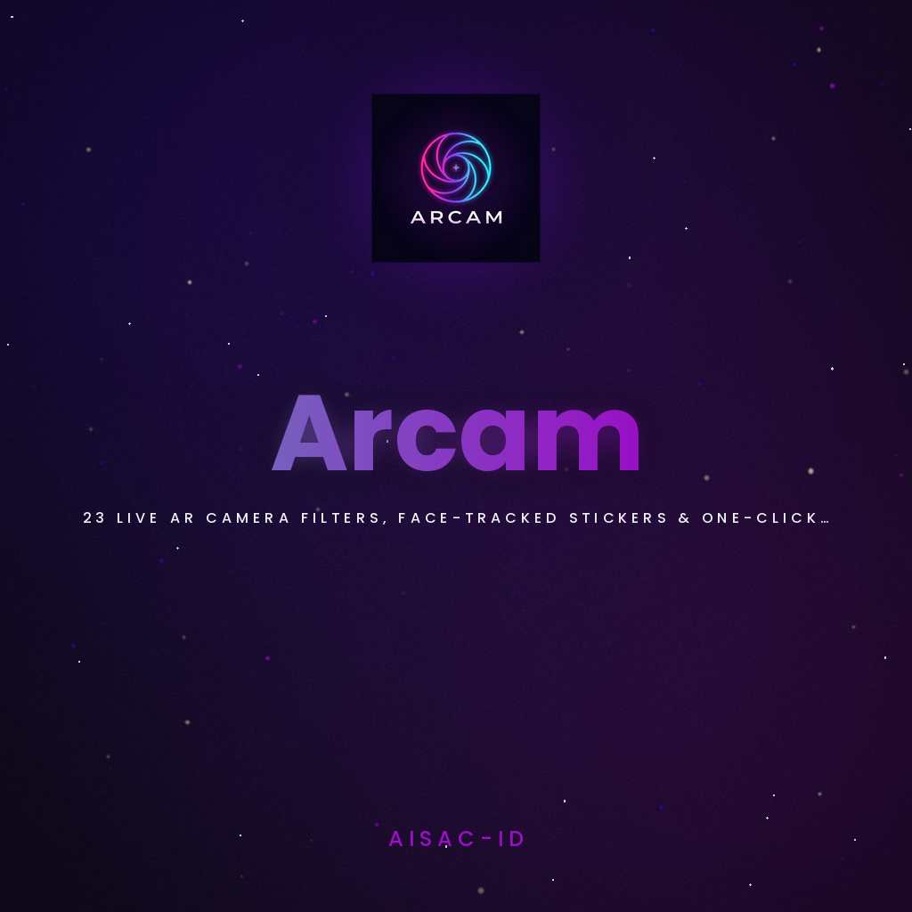 | 1080×1080 |

**Video promosi:** [promo.mp4](promo/promo.mp4)
